# Baja OS

Touchscreen dashboard for a Raspberry Pi 5 carputer in a 2005 Subaru Baja
Turbo. Python + PyQt6 backend, QML front end. It plays music from Spotify (the
official Soloist player), a phone over Bluetooth, or albums stored on the Pi;
navigates on an OpenStreetMap map stored on the Pi, so directions work with no
signal; and shows live engine data from the OBD-II port. The plan is in
[docs/ROADMAP.md](docs/ROADMAP.md) and the look in [docs/DESIGN.md](docs/DESIGN.md).

| By day | After sunset |
|---|---|
| 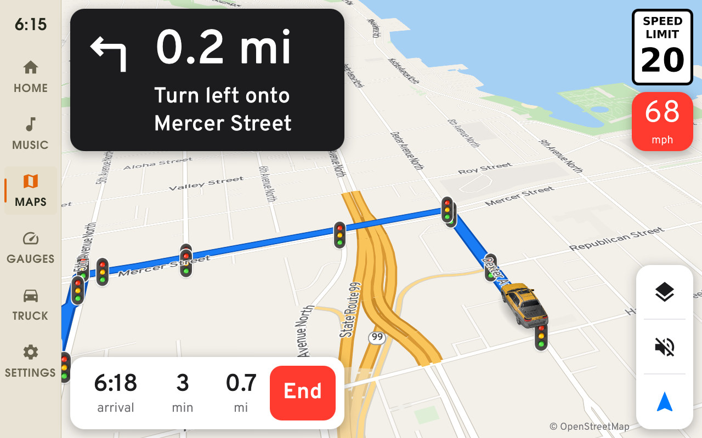 | 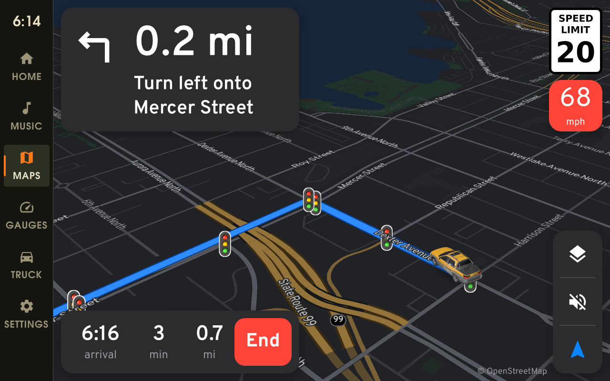 |

The truck on the map is a 3D model that leans and steers through turns. While
you're following a route, the map shows the traffic lights and stop signs
ahead, the speed limit and the next turn. It's light by day and dark after
sunset, like the rest of the dashboard.

## Screens

| Home | Home while navigating |
|---|---|
| 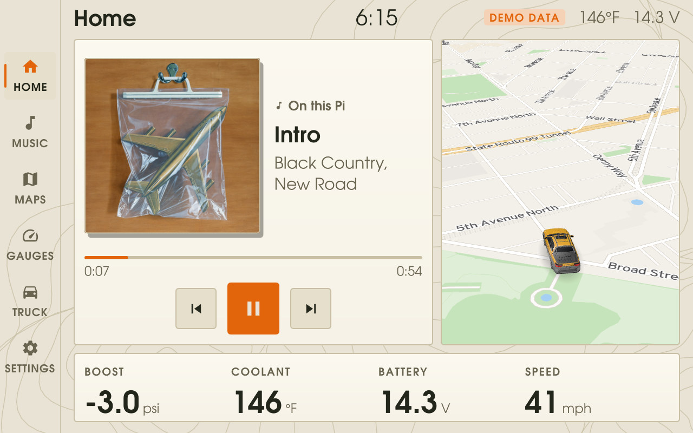 | 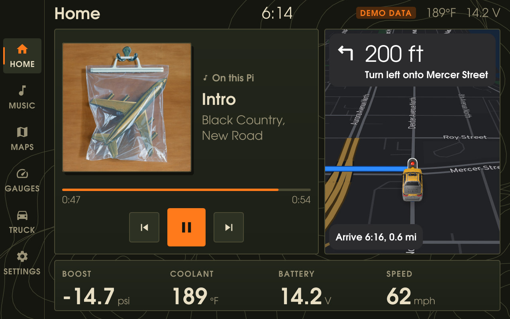 |
| **Music** | **An album on the Pi** |
| 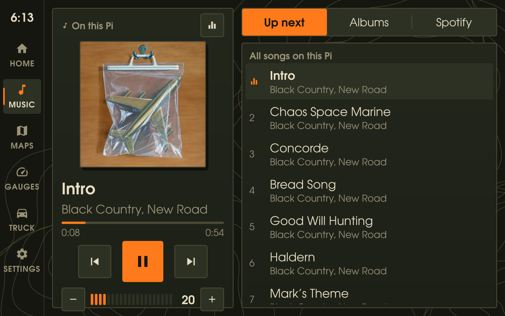 | 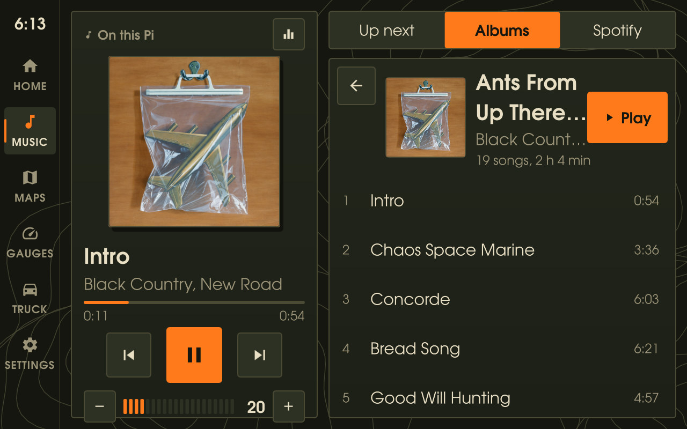 |
| **Spotify, played recently** | **Gauges** |
| 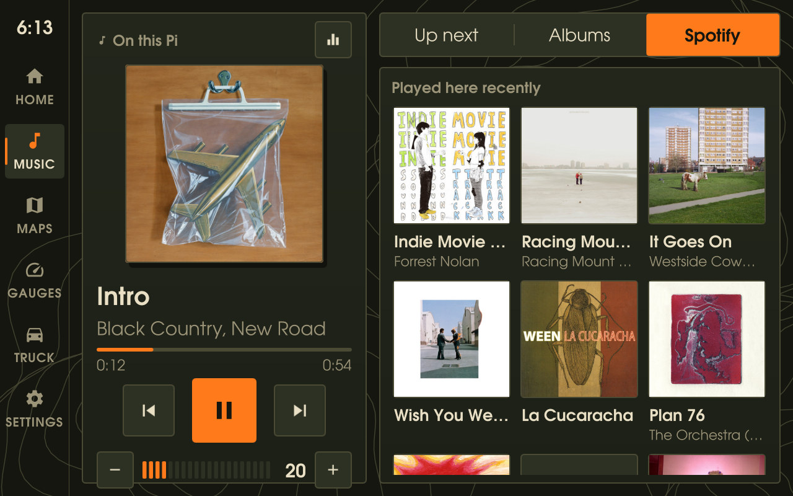 | 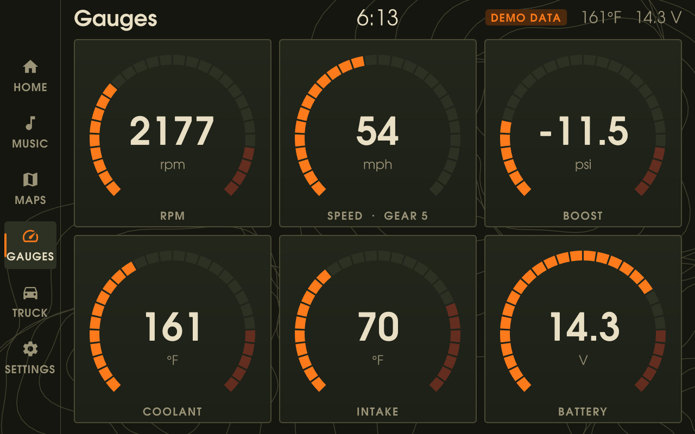 |
| **Truck** (drag to spin the 3D model) | **Settings** |
| 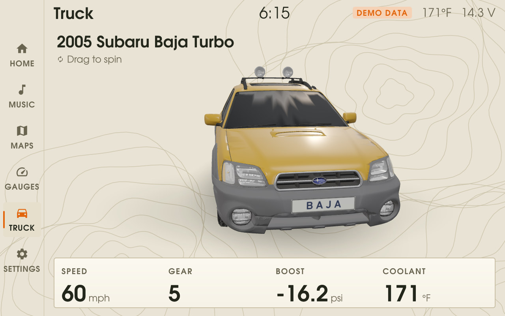 | 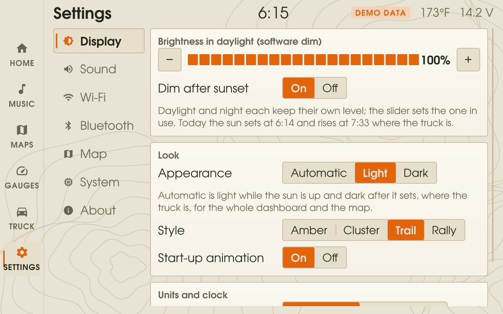 |

These were captured on the Pi's own screen with the engine off, so the
engine numbers are the simulation (the **DEMO DATA** badge in the status bar).

## Hardware

- Raspberry Pi 5, 8 GB (Raspberry Pi OS Lite 13 "trixie", 64-bit, console only)
- Waveshare 8" HDMI capacitive touch screen, 1280x800, landscape
- InnoMaker HiFi DAC HAT (PCM5122) on the Pi: the "Sound board"
- TDA7850 4-channel amp board (XH-M180) driving the truck's six speakers
- EC11 rotary encoder with push switch: the volume knob
- OBDLink EX on the OBD-II port (USB)
- u-blox 8 GPS receiver (USB)
- Car power (planned): a 12 V off-delay relay and a 12→5 V 5 A USB-C
  converter (below)
- A printed dash panel in place of the factory radio (below)

## Dash case

| The panel, screen side | The back, with the Pi case |
|---|---|
| 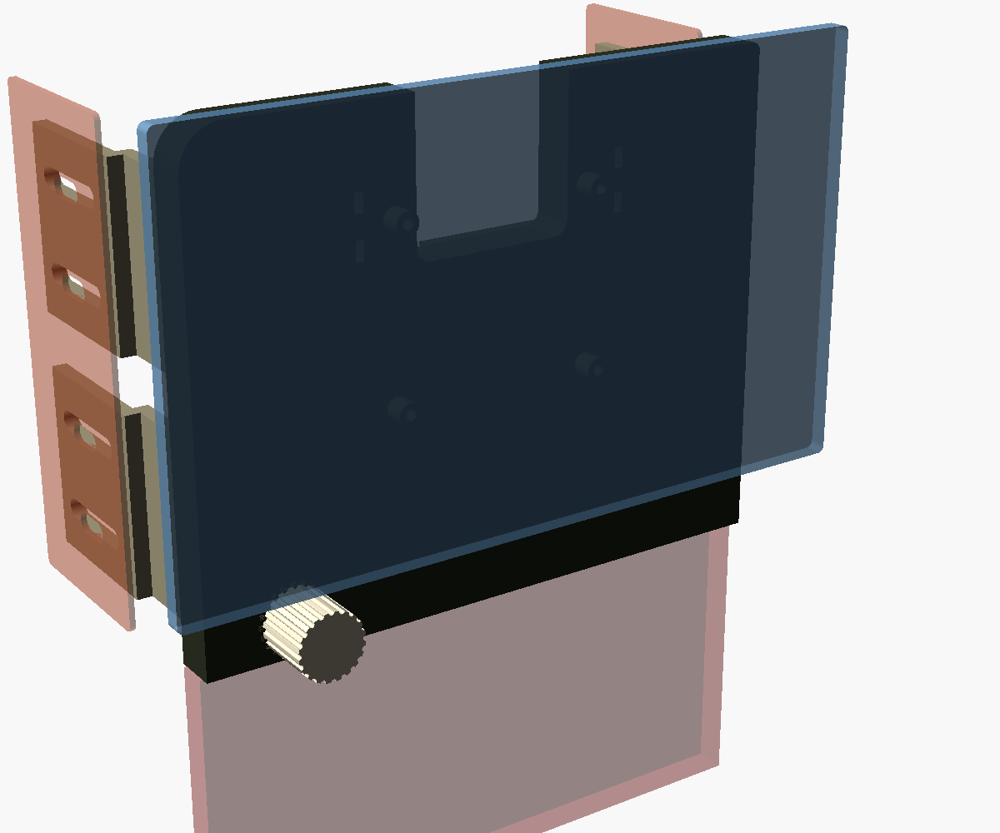 |  |

A printed panel replaces the factory radio in the center stack: the screen
bolts onto its front, the knob sits below the screen on the driver's side, and
the Pi rides in a case on its back, with the amp on a plate behind it. The print files, the Fusion model and
dimensioned drawings are in [hardware/case](hardware/case/README.md). It's a
test-fit version; some sizes are still estimates.

## Layout

```
main.py              entry point; hands the backends to QML
run.sh               Pi launcher: waits for the screen, EGLFS (GPU), falls back to linuxfb
backend/vehicle.py   engine data from the car, or a simulated drive without it
backend/obd.py       reads the car through the OBDLink EX (ELM327 commands), read-only
backend/hub.py       one `media` object over local files, the phone and Spotify
backend/library.py   albums and songs in --music-dir (default ~/Music)
backend/gapless.py   gapless playback of those files, on its own audio thread
backend/bluetooth.py phone audio over Bluetooth (BlueZ, AVRCP)
backend/spotify.py   Spotify Connect through Soloist's local API
backend/knob.py      the volume knob (EC11 on the GPIO header, libgpiod)
backend/maps.py      local web server for the offline map, and place search
backend/places.py    builds and searches the offline place index
backend/gps.py       position from the USB receiver (directly or through gpsd), or a simulated drive
backend/routing.py   turn-by-turn directions from the local Valhalla service
backend/roadinfo.py  the speed limit and name of the road the truck is on
backend/voice.py     spoken directions with Piper, music dipping underneath
backend/phone.py     "Send to Baja": a destination from the phone
backend/eq.py        the 5-band equalizer (a PipeWire filter, set live)
backend/wifi.py      Wi-Fi networks and Bluetooth tethering (NetworkManager)
backend/system.py    temperature, fan, power warnings, restart and power
backend/ignition.py  shuts the Pi down once the truck is off (the car goes quiet on the OBD adapter)
backend/display.py   screen brightness over DDC/CI (software dim fallback)
qml/Main.qml         window: nav rail + status bar + pages
qml/pages/           Home, Music, Maps, Gauges, Truck, Settings
qml/components/      Theme, Card, Gauge, NowPlaying, Readout, ...
qml/assets/truck/    the Truck page's 3D model
web/map/             the map page: MapLibre GL JS + PMTiles, three.js for the 3D truck (vendored)
deploy/              Pi setup, service, audio, Spotify and map installers
hardware/case/       the printed dash case: model, print files, drawings
tests/               tests that run on the Mac (python3 -m unittest discover tests)
tools/               scripts that build the 3D truck models and the map's sign icons
```

The UI is QtQuick and QtQuick.Layouts (no Controls or Shapes), with Quick3D
for the Truck page and WebEngine for the map.

## Run on a Mac

```bash
python3 -m venv .venv
.venv/bin/pip install -r requirements.txt
.venv/bin/python main.py
```

That installs PyQt6, Qt WebEngine (`PyQt6-WebEngine`, for the map) and
mutagen (music tags). With no truck attached, the engine data and the drive
are simulated.

## Run on the Pi

```bash
git clone https://github.com/CalebLykken/baja-OS.git
cd baja-OS
./deploy/setup-pi.sh          # packages, sound board, boot screen, service; reboot afterwards
```

After the reboot the dashboard starts by itself. To run it by hand instead,
stop the service and run `./run.sh` from the console (not over a desktop
session). Over SSH the app still draws on the HDMI screen; press Ctrl-C in the
SSH session to quit. Setup also puts your user in the groups the hardware
needs: `video`, `render` and `input` (screen and touch), `dialout` (OBD adapter
and GPS), `gpio` (knob), `i2c` (brightness) and `bluetooth`. They apply from
the next login, so the reboot covers it.

`run.sh` waits up to 30 s for a connected screen, then starts on the GPU
(EGLFS). If there's no screen, it falls back to the plain framebuffer
(`linuxfb`), which has no map. As soon as a screen is plugged in, it restarts
on the GPU by itself. Set `QT_QPA_PLATFORM` yourself to force one.

## Sound

The sound board (the DAC HAT) is the output for everything: Spotify, the
phone and the Pi's own music. `setup-pi.sh` turns it on (the
`allo-boss-dac-pcm512x-audio` overlay) and makes it the default output.
Settings > Sound > Loudest volume caps every source: keep it low for
headphones, and at 100% with the amp.

Put albums in `~/Music` on the Pi (mp3, m4a, flac, ogg, wav). The Music page
lists them under Albums, with title, artist and cover art from the tags.
Songs play back to back with no gap, so albums whose songs run into each
other sound as they should. With no files there, Home and Music say nothing's
playing (a Mac, or `--demo`, plays a demo playlist instead).

## Wiring

### The knob

Turning it changes the volume; pressing it plays or pauses. It goes on the
pin header at the USB end, clear of the sound board's pins:

| Knob | Pi pin |
|---|---|
| Outer leg | 32 (GPIO12) |
| Middle leg | 34 (ground) |
| Other outer leg | 36 (GPIO16) |
| Push switch | 37 (GPIO26) |
| Push switch | 39 (ground) |

The pins are only read (with the Pi's pull-ups), so a misplaced wire can't
harm anything. If it turns the wrong way, swap the two outer legs or flip
`FLIP` in `backend/knob.py`.

### The amp

The factory radio's plug, through an aftermarket radio harness (standard wire
colours). The six speakers are on four channels: each front tweeter shares
its side's front channel through the factory crossover, as it did with the
factory radio.

| Amp power terminal | Harness wire |
|---|---|
| REM | Red (on with the key) |
| 12V | Yellow (always on), through a 10 A inline fuse |
| GND | Black |

REM turns the amp on with the key, so it doesn't drain the battery when
parked.

| Amp speaker terminal, left to right | Harness wire |
|---|---|
| R1 − | Gray with black stripe (front right −) |
| R1 + | Gray (front right +) |
| L1 − | White with black stripe (front left −) |
| L1 + | White (front left +) |
| R2 + | Purple (rear right +) |
| R2 − | Purple with black stripe (rear right −) |
| L2 + | Green (rear left +) |
| L2 − | Green with black stripe (rear left −) |

> [!WARNING]
> The amp's outputs are bridged: never connect a speaker − wire to ground or
> to another − wire. Note the order flips halfway along the terminal block.

The sound board's RCA outputs go to the amp's RCA inputs (**Audio input 1**). Set the channel switch
so input 1 plays on all four speakers. Leave the factory FM antenna lead unplugged and taped.

### Car power and key-off shutdown

Planned: the parts aren't bought yet. The amp keeps its own power from the
radio harness (above). The Pi gets its own: an off-delay relay switches it on
with the key and holds the power for a couple of minutes after the key goes
off, which is the Pi's time to shut down properly.

The relay needs two feeds: one that's **always on** (it powers the Pi, and
keeps it powered after the key goes off) and one that's **on only with the
key** (it tells the relay when to switch).

| Wire | Goes to |
|---|---|
| Always-on 12 V, through a 5 A inline fuse | Relay module's 12 V + and its switch's COM |
| On with the key: the cigarette lighter's yellow/red wire | Relay module's trigger |
| Ground: the lighter's black wire, or a chassis bolt | Relay module's − and the converter's − |
| Relay switch NO | The converter's 12 V + |
| The converter's USB-C | The Pi's power socket |

Set the relay to hold for about 2 minutes after the trigger goes off.
Terminal names vary between modules, so go by its labels. Posi-Tap
connectors tap the lighter's wires without cutting them.

- **The lighter** is on fuse 4 (20 A, with the mirrors) and should be dead
  with the key out. Check: key out, plug a phone charger into it. If it
  charges, the lighter is always on: use it as the always-on feed instead,
  and the radio harness's red wire as the key feed.
- **Always on:** a fuse tap ("add-a-circuit") in an always-on slot of the
  fuse panel behind the coin tray keeps the Pi off the radio's fuse, with no
  cutting. Find a slot that's live with the key out (a test light on the
  fuses' test points), and match the tap to the fuse size. Or use the radio
  harness's yellow wire with its own 5 A fuse: it shares the radio's 15 A
  fuse with the amp, and the Pi draws about 2 A.

The Pi knows the truck is off through the OBD adapter, with no extra
wiring: the engine computer answers it while the key is on and goes quiet
when it's turned off. Once it's been quiet for 15 s, the dashboard shows
"The truck is off, shutting down in 10 s" with **Keep on**, then shuts the
Pi down (`backend/ignition.py`). It doesn't act before the car has answered
once since the Pi started, when the adapter is unplugged, or while the truck
is moving (the car's last speed, or the GPS).

Turn it on in **Settings > System > Shut down with key** once the Pi runs
through the relay. On any other power, a shut-down Pi stays off until it's
unplugged and plugged back in. The Pi also needs the polkit rule from
`setup-pi.sh` to shut itself down: without it the switch can't be turned on,
Settings > System says it's missing, and a shutdown that fails ends the
countdown with "Couldn't shut down" (OK puts the dashboard back) instead of
leaving it stuck at 0 s. The next key-off tries again.

The engine computer is off at ACC too, so parking with the key at ACC to keep
listening looks like the truck being off: tap Keep on. If the key then goes
fully off without the car answering again, the relay cuts the power after its
hold time, without a shutdown.

#### Bootloader settings for the converter

The converter gives a steady 5 V but doesn't speak USB PD (power delivery),
so the Pi can't tell it's a 5 A supply. It then shares only 600 mA between
its USB ports (the screen's USB lead, the GPS and the OBD adapter) and may
warn about the power supply. Two settings in the Pi's bootloader (its
EEPROM, not `config.txt`) sort this out:

- `PSU_MAX_CURRENT=5000`: skip the USB PD check and treat the supply as
  5 A, so the USB ports get 1.6 A. Only with a supply that really gives
  5 A. It replaces `usb_max_current_enable=1` in `config.txt`.
- `POWER_OFF_ON_HALT=1`: once shut down, the Pi switches its power chip
  fully off and draws about 0.01 W instead of 1-1.4 W. The relay cuts the
  power a couple of minutes later anyway; this keeps the drain tiny when it doesn't
  (the key back on during a shutdown, or a stuck relay).

On the Pi:

```bash
sudo rpi-eeprom-config --edit
```

It opens the bootloader settings in an editor. Make the two lines read
`PSU_MAX_CURRENT=5000` and `POWER_OFF_ON_HALT=1` (change them if they're
there, otherwise add them at the end), save and quit (in nano: Ctrl-O,
Enter, Ctrl-X), then `sudo reboot`. Afterwards `rpi-eeprom-config` lists
both, and Settings > System shouldn't show a power warning with everything
running.

## Engine data (OBD-II)

`backend/obd.py` reads the car through the OBDLink EX. The 2005 Baja speaks
ISO 14230-4 (KWP, over the K-line). Every round it reads RPM, manifold
pressure (for boost) and speed, plus one of coolant temperature, intake air
temperature and battery voltage, up to 10 updates a second. Boost is measured
against the outside air pressure: the car's own reading (PID 0x33) if its engine
computer has one, else the manifold pressure at key-on with the engine stopped.
The last one is kept in the settings (`baro`), so boost is right after a restart
with the engine already running. The journal lists the PIDs the car supports
(`journalctl -u baja-os | grep "OBD: PIDs"`).

It only reads: it never clears codes or sends anything that writes. With the
key off it checks every few seconds, then every 20 s after a minute, so the
adapter can sleep. Until the car has answered once on an install (a Mac, a bench
Pi), the gauges run a simulated drive and the status bar shows **DEMO DATA**.
After that, the truck never makes numbers up: with the car silent the engine
values are dashes, and the battery stays real (the adapter reads it itself).
`--demo` and `--no-demo` force the choice.

While the car's own readings are out of range (coolant over 230 °F, battery
under 12 V or over 15 V, boost over 15 psi), a red chip at the foot of the
nav rail shows the reading on every page, Maps and Music included; tap it
for the gauges. The thresholds are `LIMITS` in `backend/vehicle.py`. The
simulated data never warns.

## GPS

The u-blox receiver is read straight from its USB serial port (NMEA), or
through gpsd if gpsd is running. Settings > Map > GPS shows how many
satellites it can see, and when it has found your position. If it loses the
sky on the way (a tunnel, a garage), the map holds the last position and
directions wait until it's back. With no receiver and no engine data (a Mac,
or a Pi on the bench), the map follows a simulated drive around Seattle.

It needs a view of the sky: put it on top of the dash, under the windshield,
on a USB extension cable. Keep it away from the Pi and the screen, which give
off radio noise at GPS frequencies. Behind the dash, it won't find
satellites.

## Spotify

The Pi is a Spotify Connect speaker called **Baja**, through Soloist,
Spotify's official headless player (needs Premium):

```bash
./deploy/spotify/set-spotify-key.sh   # paste your key from developer.spotify.com/dashboard/soloist
./deploy/spotify/install-soloist.sh   # the player, its service, and a daily updater
```

The first time, with your phone on the same Wi-Fi as the Pi, open Spotify,
tap the devices button on Now Playing, and pick **Baja**. The Pi remembers
the sign-in. It starts Spotify once it's online, so in the truck it connects
when the phone's hotspot comes up. The Music page's Spotify tab lists what's
been played on the Pi recently, for one-tap replay.

## Equalizer

Five bands (bass, low mid, mid, presence, treble) with presets, on the Music
page (the equalizer key) and in Settings > Sound. PipeWire does the filtering
in front of the speakers, so it applies to Spotify, the phone and local files
alike. `setup-pi.sh` installs it; on its own:

```bash
./deploy/audio/install-eq.sh            # no sudo; --remove takes it out again
```

## Wi-Fi and the phone's hotspot

Settings > Wi-Fi lists nearby networks; tap one and type its password on the
on-screen keyboard. For an iPhone hotspot, turn on Personal Hotspot and keep
that screen open while you join. Networks joined this way retry forever, so
the Pi picks the hotspot up by itself whenever the phone is in the truck. If
there's no Wi-Fi for a minute, it uses the paired phone over Bluetooth instead
(Settings > Wi-Fi > Phone as backup). Joining networks, rebooting and shutting
down from the dashboard need the polkit rule that `setup-pi.sh` installs.

## Offline map

```bash
./deploy/maps/install-map.sh   # Seattle area, about 130 MB; safe to re-run to update
```

This cuts the Seattle area (Tacoma to Everett, Bremerton to North Bend) out of
Protomaps' daily OpenStreetMap build, with the label fonts and icons, into
`~/.local/share/baja-os/maps`, then indexes every named place, business and
street in it for the search key on the Maps page (`backend/places.py`). After
that the map and search need no internet. Set
`REGION` and `BBOX` for a different area (the script shows how). It builds the
new map in a `.new` folder inside the maps folder (not in `/tmp`, which is RAM)
and renames it into place at the end, so the map can stay open while it runs.
The map is MapLibre GL JS in Qt WebEngine, coloured from the current style, and
starts the first time the Maps page opens.

Search on the Maps page finds places, businesses and streets in the map with
no signal. For turn-by-turn directions and the spoken voice, run these once on
the Pi (no sudo; each installs into `~/.local/share/baja-os`):

```bash
./deploy/maps/install-routing.sh     # Valhalla + Washington's roads: 365 MB, about half an hour
./deploy/audio/install-voice.sh      # Piper + the public-domain "kristin" voice, about 100 MB
```

Search takes places, businesses, street addresses ("400 Broad St") and one-tap
categories (gas, food, coffee, parking, EV charging, groceries). Pick a place
and the route is worked out straight away; tap Go for turn-by-turn directions
(spoken directions are off until turned on). The map fills the screen beside
the rail and also runs small on the Home screen. The 3D truck and the sign
icons are built by the scripts in `tools/` (see `tools/sign-icons/` for the
icons' sources and licences).

To send a place from the iPhone, scan the QR code in Settings > Map: it opens a
page on the Pi with a paste box and the steps for a "Send to Baja" Share-sheet
Shortcut.

To work on the map in a desktop browser:

```bash
python3 -m backend.maps --port 8765    # then open http://127.0.0.1:8765/
```

## Pi setup (boot, Wi-Fi, service)

```bash
./deploy/setup-pi.sh          # asks for sudo once; safe to re-run; reboot afterwards
./deploy/quiet-boot-undo.sh   # puts the original boot screen and console back
```

`setup-pi.sh` installs the packages, adds your user to the groups the hardware
needs, turns on the sound board, makes Wi-Fi keep retrying at boot (power
saving off), hides the rainbow screen, kernel text, logos and console login,
installs the Baja OS boot screen, sets up the polkit rule that lets the
dashboard shut the Pi down, and installs
`baja-os.service`, which takes the display straight from the boot screen so
the truck stays up until the dashboard appears. It also lets your user
restart that one service without a password:

```bash
sudo systemctl restart baja-os
journalctl -u baja-os -f
```

Ctrl+Alt+F2 still gives you a text login on the Pi itself.

Style, volume and units are saved to `~/.config/baja-os/baja-os.conf` and
restored on the next start. `--style` overrides the saved style for one run.

## Deploying updates

From the Mac:

```bash
./deploy/push.sh        # copies to baja.local, stamps the version, restarts
```

Or on the Pi: `git pull && sudo systemctl restart baja-os`.

## Next steps

See [docs/ROADMAP.md](docs/ROADMAP.md).
