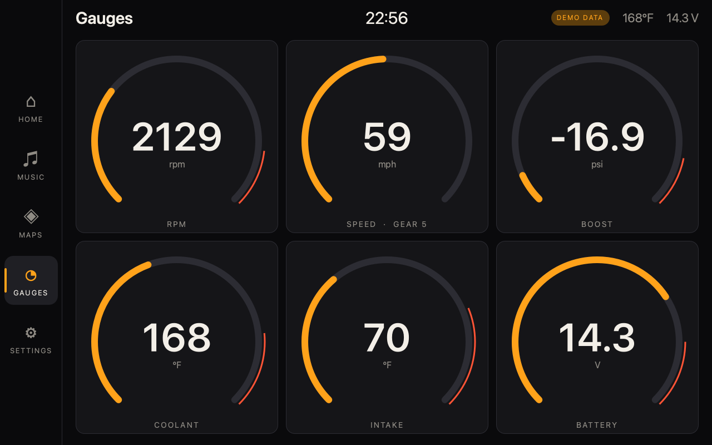

# Baja OS

Touchscreen dashboard for a Raspberry Pi carputer in a 2005 Subaru Baja Turbo.
Python + PyQt6 backend, QML front end. Vehicle and media data are simulated for
now (the **DEMO DATA** badge in the status bar), so the UI can be built before
the OBD-II adapter, CarPlay dongle and audio are wired in.


| Music | Gauges |
|---|---|
|  |  |

## Hardware

- Waveshare 8" HDMI capacitive touch, 1280x800, landscape
- Raspberry Pi 2 for testing (Raspberry Pi OS 13 "trixie", 32-bit, console only); Raspberry Pi 5 in the car

## Layout

```
main.py              entry point; exposes `vehicle`, `media`, `demoMode` to QML
run.sh               Pi launcher (EGLFS, falls back to linuxfb)
backend/vehicle.py   simulated drive: rpm, speed, boost, coolant, intake, volts, gear
backend/media.py     demo playlist (used when there's no music)
backend/library.py   plays real files from --music-dir (default ~/Music)
backend/display.py   screen brightness over DDC/CI (software dim fallback)
qml/Main.qml         window: nav rail + status bar + pages
qml/pages/           Home, Music, Maps (CarPlay placeholder), Gauges, Settings
qml/components/      Theme, Card, Gauge, NowPlaying, Readout, ...
```

The UI uses only QtQuick and QtQuick.Layouts (no Controls or Shapes) to keep
the Pi's dependency list small.

## Run on a Mac

```bash
python3 -m venv .venv
.venv/bin/pip install -r requirements.txt
.venv/bin/python main.py
```

## Run on the Pi

PySide6 isn't packaged for the 32-bit Pi, so install PyQt6 from apt:

```bash
sudo apt install python3-pyqt6.qtmultimedia python3-mutagen python3-pyqt6 python3-pyqt6.qtqml python3-pyqt6.qtquick qml6-module-qtquick qml6-module-qtquick-layouts qml6-module-qtquick-window qml6-module-qtqml-workerscript
```

Then from the console (not over a desktop session):

```bash
git clone https://github.com/CalebLykken/baja-OS.git
cd baja-OS
./run.sh
```

`run.sh` tries `QT_QPA_PLATFORM=eglfs` and falls back to `linuxfb`. Set
`QT_QPA_PLATFORM` yourself to force one. Over SSH the app still draws on the
HDMI panel; press Ctrl-C in the SSH session to quit. Your user needs to be in
the `video`, `render` and `input` groups for the display and touch to work.

## Music

Put audio files (mp3, m4a, flac, ogg, wav) in `~/Music` on the Pi, or pass
`--music-dir`. Title, artist and embedded cover art come from the file tags.
With no files there, the Music page plays the demo playlist. Audio goes to the
default PipeWire output (the Pi's 3.5 mm jack).

## Start on boot

```bash
./deploy/install-service.sh
```

Installs a systemd user service (with lingering, so no login is needed) that
starts Baja OS full screen at power-on and restarts it if it crashes.
`systemctl --user stop baja-os` stops it; `systemctl --user disable baja-os`
turns boot start off.

Style, volume and units are saved to `~/.config/baja-os/baja-os.conf` and
restored on the next start. `--style` overrides the saved style for one run.

## Deploying updates

```bash
git pull && systemctl --user restart baja-os
```

## Next steps

- Swap `VehicleData._tick` for real OBD-II PID reads (same property names, QML unchanged)
- Real audio backend in `MediaPlayer`; wire `volumeUp`/`volumeDown` to the dash knob
- CarPlay via the Carlinkit dongle on the Maps page
- Start on boot (systemd unit)
