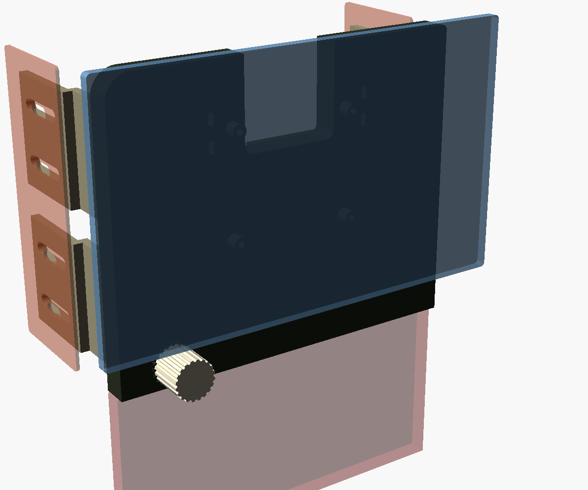
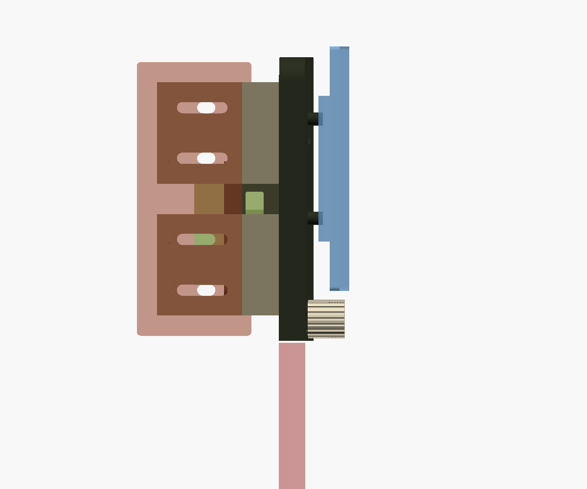
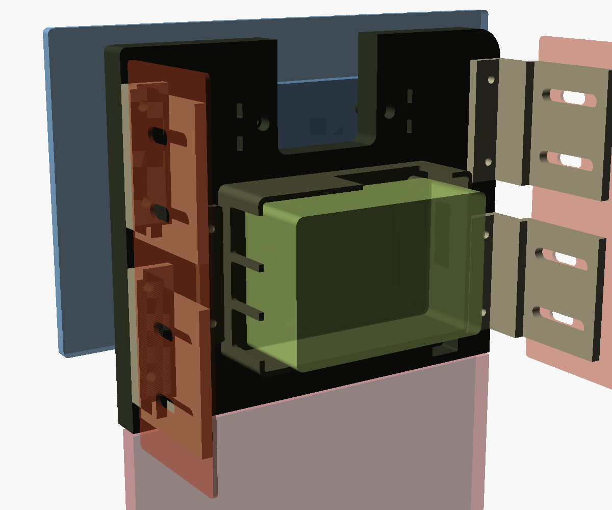
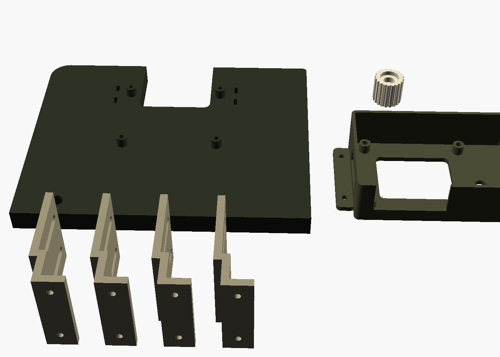

# Baja OS dash case

A printed panel that replaces the factory radio in the 2005 Baja's center
stack: the 8" screen bolts to a carrier that hangs on its front (so the screen
comes off from the front, after the silver trim is on), the volume knob sits
under the screen on the driver's side, the Raspberry Pi rides in a case on its
back with the amp and the Mean Well power converter on a plate behind it, and
four adapter plates tie it to Subaru's radio brackets. The factory climate
controls stay where they are, below it.

This is a **test-fit version**. Some sizes are estimates (see
[What we know](#what-we-know)); print it, try it in the truck, measure, and
update the numbers.

| Side | Back |
|---|---|
|  |  |

Blue is the screen, green the Pi and DAC, pink the climate controls, red the
factory brackets (placeholders; their real shape isn't known yet).

## Print it

Send the six files in [`print/`](print/) to the printer or print service.
Each one is already laid on its best side, and none needs supports.

| File | Copies | Sits on the bed | Size (mm) |
|---|---|---|---|
| `print/dash-panel.stl` | 1 | back face down, pocket and hooks up | 177 × 143 × 17 |
| `print/screen-carrier.stl` | 1 | back face down, screen posts up | 163 × 118 × 9 |
| `print/pi-case.stl` | 1 | floor down, open side and amp posts up | 117 × 82 × 48 |
| `print/amp-plate.stl` | 1 | flat, posts up | 131 × 89 × 36 |
| `print/volume-knob.stl` | 1 | top down, shaft hole up | 19 × 19 × 18 |
| `print/adapter-plate.stl` | **4** | standing on its Z-shaped end | 20 × 60 × 50 |

The same adapter plate fits the left and the right side (it's turned around).

**Material:** for the test fit, anything works; PLA is cheapest. For the
truck, print in **ASA** (it handles dash heat; PLA and PETG soften in a hot
car). ABS is the fallback if ASA isn't offered.

**Settings:** 0.2 mm layers, 4 walls, 5 top and bottom layers, 30 % infill,
no supports. The adapter plates' slots bridge about 30 mm, which any printer
handles.

## Drawings

Dimensioned drawings of each printed part, to check a test print with a ruler
and calipers: [all nine in one PDF](drawings/baja-dash-case-drawings.pdf), or
[panel front](drawings/1-dash-panel-front.png),
[panel top and the lip](drawings/2-dash-panel-top-and-lip.png),
[panel back](drawings/3-dash-panel-back.png),
[screen carrier](drawings/4-screen-carrier.png),
[adapter plate](drawings/5-adapter-plate.png),
[Pi case](drawings/6-pi-case.png),
[amp plate](drawings/7-amp-plate.png),
[volume knob](drawings/8-volume-knob.png) and
[assembly side view](drawings/9-assembly-side.png).

The letter after each size says how sure it is: **M** measured (or from a
datasheet), **D** a design choice, **E** estimated, **U** unknown. The print
should match every size; E and U are the ones to check against the truck.
Printed at 100 % on US Letter, the panel, Pi case and assembly sheets are full
size, so you can lay the part on the paper (so are the carrier and the amp plate); the adapter is
2:1, the knob 3:1.

[`make_drawings.py`](make_drawings.py) makes them from the Fusion script's own
code: `python3 hardware/case/make_drawings.py` (needs matplotlib). It uses the
sizes in the script's `PARAMETERS` list, so if you change one in Fusion, change
it there too before re-running; it warns when `print/` doesn't match.

## What to buy

| Qty | Part | For |
|---|---|---|
| 22 | M3 heat-set inserts (for a 4 mm hole, about 6 mm long) | panel back: 8 for the adapters, 4 for the Pi case; 2 in the panel's pocket for the lock screws; 4 in the Pi case's tall posts; 4 in the amp plate for the Mean Well |
| 22 | M3 × 8 mm screws (button head for the 2 lock screws) | adapters and Pi case to the panel; amp plate to the Pi case; screen carrier lock; Mean Well to the amp plate |
| 4 | M2 heat-set inserts (for a 3.2 mm hole, 3–4 mm long) | amp plate posts |
| 4 | M2 × 6 mm screws | amp to the amp plate (its holes are about 2.5 mm) |
| 4 | M2.5 heat-set inserts (for a 3.6 mm hole) | Pi case standoffs |
| 4 | M2.5 male-female standoffs, tall enough for the DAC HAT over the cooler (often in the HAT kit) | Pi + DAC stack |
| 4 | M2.5 × 6 mm screws | top of the HAT |
| 4 | M2.5 × 8 mm screws | screen to the carrier, from the carrier's back |
| 8 | M5 × 16 mm screws, nuts and 16 washers (or Subaru's own screws) | adapters to the factory brackets |
| 1 | Short micro-HDMI to HDMI cable with a right-angle HDMI end | screen to Pi; the screen's plugs point up, so 90° ends keep them inside the notch |
| 1 | Short right-angle USB cable for the screen's touch port | screen to Pi |
| a few | Small zip ties (2.5 mm) | cable strain relief beside the notch |

Already have: the EC11 encoder (with its nut and washer), the Pi 5 with its
active cooler, the InnoMaker DAC HAT, the screen, the amp (Taidacent XH-M180),
the Mean Well RSD-30G-5.

## Put it together

1. **Inserts.** With a soldering iron, press the M3 inserts into the 12 holes
   on the back of the panel, the 2 in the pocket on its front (below the
   screen), the Pi case's four tall posts and the amp plate's four short
   Mean Well bosses; the M2.5 inserts into the Pi case's four short posts; and
   the M2 inserts into the amp plate's four tall posts.
2. **Knob.** Push the encoder into the square pocket on the back of the panel
   so its threaded collar comes through the front. Put the washer and nut on
   from the front, then press the knob onto the shaft. The knob is closed on
   top; trim the shaft if it's longer than 20 mm.
3. **Screen onto its carrier** (on the bench). Lay the screen face down on a
   towel and set the carrier on it, posts down, so the posts meet the screen's
   four mounting holes and the plugs sit in the carrier's notch. Screw it on
   from the carrier's back with the M2.5 × 8 screws; their heads sink into the
   counterbores. Plug the HDMI and USB cables in and zip-tie them through the
   slots beside the notch (the tie passes behind the carrier in the groove), so
   the cables come off with the screen.
4. **Pi case.** Screw the case to the panel through its two side tabs (M3 × 8).
   Then fit the Pi on the standoffs and the DAC HAT on top.
5. **Mean Well and amp.** Plug the sound cable into the DAC first. Screw the
   amp plate onto the Pi case's four tall posts (M3 × 8), its posts facing away
   from the Pi. Screw the Mean Well onto the four short bosses in the middle
   (M3 × 8), terminals to the left and right, and **wire it now**: the amp
   board covers its terminals. Its output − must not touch the truck's or the
   amp's ground. Then screw the amp onto the four tall posts (M2 × 6), over the
   Mean Well, its parts facing away, so its heat goes into the dash rather than
   onto the Pi. The amp has to come off to reach the Mean Well, and both to
   reach the Pi.
6. **Adapter plates.** Screw two to each side of the panel's back (M3 × 8),
   slotted walls facing out.
   The panel has a 3 mm lip on its left, right and top edges at the back, like
   the factory radio, so the silver frame's edge holds it in. The lip follows
   the rounded top-right corner and is square at the top left.
7. **In the truck.** Slide the panel into the radio opening. The adapters'
   slots should land on the Subaru brackets' screw holes; the slots allow
   front-to-back adjustment. Bolt them with M5 screws. Then put the silver
   frame back on.
8. **Hang the screen.** Feed the screen's cables back through the notch and
   plug them into the Pi (leave a few cm of slack behind the panel). Hold the
   screen about 4 mm higher than where it ends up, push the carrier into the
   pocket so the two hooks come through its slots, and let it drop: it rests
   on the hooks, whose tips hold it in. Put the two M3 lock screws through the
   strip under the screen.

**Taking the screen off:** undo the two lock screws, lift the screen about
4 mm, tilt the bottom toward you and pull it off the hooks. Unplug the cables,
or let it hang on them.

The knob is wired straight to the Pi for now (pins 32, 34, 36, 37, 39); in
the truck, solder it and add a latching connector between the panel and the Pi.

## Test fit: what to check

Each line names the Fusion parameter to change if it's off.

- [ ] Each printed part measures as its [drawing](#drawings) says
- [ ] The panel slides into the opening snugly, not forced (`FitGap`, add 0.2–0.4 mm)
- [ ] The climate controls clear the bottom of the panel (`ClimateGap`)
- [ ] The screen's four holes line up with the carrier's posts (`ScreenMountOffsetX`, `ScreenMountOffsetY`, `ScreenMountHoleSpacing`)
- [ ] The carrier drops onto the hooks, sits flush in the pocket and lifts off again (`CarrierThickness`, `CarrierHookInset`)
- [ ] The lock screws can be reached under the screen (`CarrierTabDrop`, `CarrierLockScrewX`)
- [ ] The silver frame goes on with the panel in place and the screen off
- [ ] The screen's plugs fit in the notch (`PlugAreaBottom`, `CableClearance`)
- [ ] The top of the screen clears the vents and the hazard switch (`ScreenOverhangTop`)
- [ ] The knob turns freely between the screen and the climate controls (`KnobY`, `KnobDiameter`)
- [ ] The encoder's nut reaches through the panel (`EncoderWall`)
- [ ] The adapter walls touch the Subaru brackets (`BracketSeparation`)
- [ ] The slots line up with the brackets' screw holes (`FactoryBracketUpperY`, `FactoryBracketLowerY`, `FactoryBracketHoleSpacing`)
- [ ] The adapters clear the back edges of the silver bezel (`BezelReturnDepth`)
- [ ] The Pi case fits behind the dash with room for air and cables
- [ ] The amp's four holes line up with the amp plate's posts (`AmpHoleSpacingX`, `AmpHoleSpacingY`)
- [ ] The Mean Well's four holes line up with its bosses, and the amp board clears it (`MeanWellHoleSpacingX`, `AmpStandoffHeight`)
- [ ] The amp plate clears the DAC HAT (`AmpClearance`, `PiStackHeight`)
- [ ] There's room behind the dash for the amp: it reaches about 11.5 cm behind the panel
- [ ] The screen is clear of the passenger airbag, within about 30° below your line of sight, and readable in daylight

## What we know

| Size | Value | How sure |
|---|---|---|
| Bezel opening | 171.45 × 222.25 mm (6 3/4 × 8 3/4 in) | measured by Caleb |
| Opening corners | top-left R 15 mm, top-right R 3 mm (re-measured after the first test print), bottom square; the panel's corners are 0.5 mm rounder so they don't bind | measured by Caleb |
| Climate controls | bottom 82.55 mm (3 1/4 in) of the opening, full width | measured by Caleb |
| Screen | Waveshare 8DP-CAPLCD: glass 194 × 119 mm, 4.8 mm glass + LCD | Waveshare's drawing; Caleb's caliper check of the holes matches it |
| Screen mounting holes | Raspberry Pi pattern, 58 × 49 mm, centre 12.2 mm left of and 3.2 mm below the glass centre (from the front) | Waveshare's drawing (Caleb measured 12.8 and 3.9) |
| Screen depth to its mounting nuts | 11.4 mm | Waveshare's drawing |
| Screen plugs | HDMI, USB and USB-C on the board's top edge, facing up | Waveshare's drawing; Caleb confirmed the HDMI |
| Silver frame | 10 mm thick at the opening's edge; the panel's lip reaches 3 mm past it on the left, right and top | measured by Caleb |
| Amp hole spacing | Taidacent XH-M180, 118 × 76 mm centre to centre; holes about 2.5 mm | measured by Caleb |
| Amp board | 125 × 83 mm (the holes plus 3.5 mm each side) | estimated; measure |
| Mean Well RSD-30G-5 | 113 × 60 × 25 mm; four Ø3.5 holes 105 × 52 mm apart, terminals on the short ends | [Mean Well datasheet](https://www.meanwell.com/Upload/PDF/RSD-30/RSD-30-spec.pdf), case 253A |
| Amp height with its heatsink | 29 mm | from the seller's listing |
| Pi 5 holes and ports | 58 × 49 mm holes; port positions | [Raspberry Pi 5 mechanical drawing](https://datasheets.raspberrypi.com/rpi5/raspberry-pi-5-mechanical-drawing.pdf) |
| Encoder | EC11, M7 collar, 6 mm D shaft; its square pocket in the panel is 15 × 15 mm | pocket measured by Caleb; collar and flat estimated from the EC11 standard |
| Factory brackets | 66201AE17A (left), 66201AE18A (right) | Subaru part listings ([left](https://www.subarupartsdeal.com/parts/subaru-bracket-radio~66201ae17a.html), [right](https://www.subarupartsdeal.com/parts/subaru-bracket-radio~66201ae18a.html)); pictures only, no dimensions |
| Bracket screws | M5 × 16 (Subaru 045005160 up to 2004, Q500025 from 2005) | estimated from Subaru's part-number pattern |
| Distance between the brackets | 180 mm | estimated (a common radio width); measure |
| Bracket hole heights and spacing | 120 / 185 mm, 25 mm apart | unknown; placeholders to measure |
| Bezel wall depth behind the panel | 20 mm | unknown; placeholder to measure |

Every one of these is a named parameter in Fusion (Modify → Change
Parameters), with the same notes.

## Change the design

The model is built by a Fusion script, so every size can change.

1. In Fusion: **Utilities → Add-Ins → Scripts and Add-Ins**, click **+**,
   choose *Script or add-in from my computer*, and pick the folder
   `hardware/case/fusion/BajaDashCase`.
2. Run it. The first run makes a new design.
3. Change sizes in **Modify → Change Parameters**, then run it again with that
   design open. It rebuilds the parts from the new numbers, and only ever
   rebuilds the design it made.

Each run refreshes `print/`, `baja-dash-case.step` (the whole assembly, for
any CAD program) and `baja-dash-case.f3d` (a Fusion archive). It writes the
parts in their places on the dash to `build/` (not kept in git), and
[`make_print_files.py`](make_print_files.py) turns them into the print files.
That tool runs on its own too: `python3 hardware/case/make_print_files.py`.

## For the truck, later

From the roadmap's mount rules: ASA (not PETG) for anything in the sun, metal
inserts and screws, strain relief on the HDMI and USB cables, clear of the
passenger airbag, the vents and the hazard switch. Check the Pi's
temperature on a hot day; it slows itself down past about 80 °C. A small hood
or anti-glare film helps in daylight. The LED halo around the knob is still to
come; the panel has room around the knob for it.
